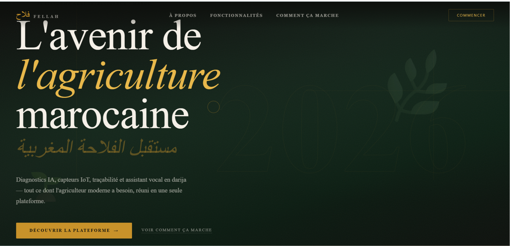
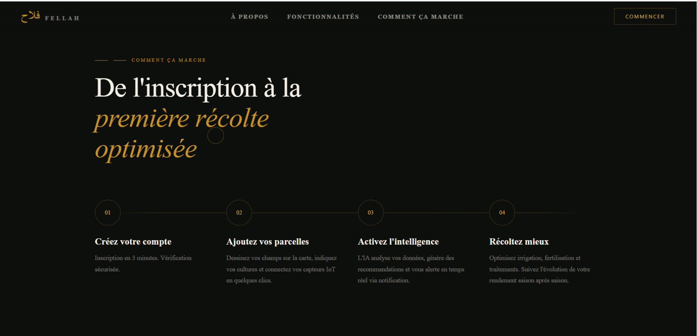
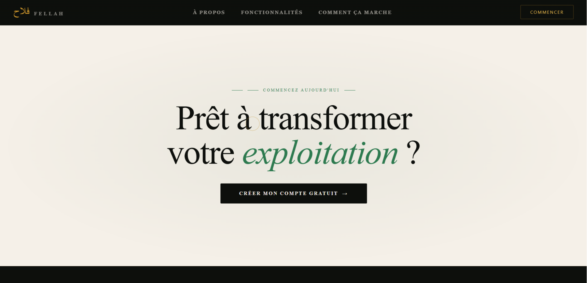

# 🌱 Fellah | فَلاَّح
### La technologie au service de l'agriculture marocaine

**Fellah (فَلاَّح)** est une plateforme web de gestion et d'accompagnement agricole, conçue pour faciliter la digitalisation des activités agricoles et rapprocher les différents acteurs du secteur.

Développé avec une orientation particulière vers les exploitations agricoles de la région de **Doukkala au Maroc**, le projet rassemble dans un même environnement des outils de gestion agricole, un espace de commercialisation des produits, des services d'assistance et des prototypes basés sur l'intelligence artificielle.

L'ambition de Fellah est de proposer une solution numérique centralisée, accessible et évolutive, qui accompagne les agriculteurs dans certaines de leurs activités quotidiennes.

> **Fellah, c'est une approche numérique de l'agriculture : gérer, commercialiser et mieux comprendre son exploitation.**

---

##  Découvrir Fellah

### Interface d'accueil

L'interface d'accueil constitue le point d'entrée de la plateforme et présente son univers graphique ainsi que les principaux services proposés.

| Accueil — Vue 1 | Accueil — Vue 2 | Accueil — Vue 3 |
|:---:|:---:|:---:|
|  |  |  |

---

##  Objectifs du projet

Fellah s'articule autour de plusieurs objectifs :

- **Digitaliser la gestion agricole :** centraliser les informations relatives aux utilisateurs, aux exploitations et aux parcelles.
- **Faciliter la commercialisation :** proposer un espace de mise en relation autour des produits agricoles.
- **Exploiter les données agricoles :** intégrer des paramètres liés aux cultures, aux sols, à l'irrigation et à la fertilisation.
- **Explorer l'intelligence artificielle :** développer des services d'assistance et d'estimation à partir de technologies adaptées.
- **Proposer une solution évolutive :** organiser les différents composants dans une architecture modulaire.

---

## ✨ Fonctionnalités de la plateforme

### 1.  Gestion des utilisateurs

La plateforme comprend des fonctionnalités de gestion des comptes et des profils.

- Création et gestion des comptes.
- Authentification des utilisateurs.
- Gestion des profils.
- Espaces adaptés aux différents acteurs de la plateforme.

### 2.  Gestion des parcelles agricoles

Un espace consacré à la gestion et à la visualisation des parcelles.

- Gestion des informations relatives aux parcelles.
- Consultation des données agricoles.
- Visualisation géographique des parcelles sur une carte.

### 3.  Marketplace agricole

Un espace de commercialisation destiné à faciliter la consultation et la gestion des produits agricoles.

- Consultation des produits disponibles.
- Espace vendeur.
- Gestion des produits.
- Gestion des commandes.

### 4.  Estimation du rendement agricole

Le projet intègre une API Python dédiée à l'estimation du rendement agricole.

Les paramètres pris en compte comprennent :

- Le type de culture.
- Les caractéristiques du sol.
- Les informations relatives à l'irrigation.
- Les apports en nutriments NPK (azote, phosphore et potassium).

Un modèle de machine learning est prévu pour exploiter ces paramètres et produire une estimation.

**Important :** le modèle utilise actuellement un dataset synthétique. Ses résultats ne doivent donc pas être interprétés comme des prévisions agronomiques validées sur le terrain.

### 5.  AgroBot – Assistant agricole

AgroBot est un service d'assistance agricole développé avec FastAPI.

Le composant comprend notamment :

- Une interface de questions-réponses.
- L'intégration du service Groq.
- Le traitement de fichiers audio.
- La transcription audio en texte.
- La génération vocale avec gTTS.

La disponibilité des réponses dépend de la configuration de la clé API et des services externes.

### 6. Diagnostic des plantes

Le projet comprend une interface consacrée au diagnostic des plantes à partir de photographies.

Cette partie représente une piste d'intégration de l'intelligence artificielle dans l'identification des problèmes phytosanitaires.

**État actuel :** l'interface existe, mais le service de prédiction utilisé ne dispose pas encore d'un schéma adapté à la classification d'images. Le diagnostic ne doit donc pas être considéré comme opérationnel.

### 7.  Passeport numérique agricole

Une interface dédiée au passeport numérique est également présente dans le projet.

Elle constitue une base pour envisager la centralisation et la consultation d'informations relatives à un produit ou à son parcours agricole. Son fonctionnement complet nécessite des développements et intégrations supplémentaires.

---

##  Architecture du projet

Fellah repose sur une architecture modulaire composée de plusieurs applications et services indépendants.

```text
Fellah/
│
├── frontend/
│   └── agro/
│       ├── src/
│       ├── public/
│       ├── train_modele_corrige.py
│       └── dataset_synthetique_corrige.csv
│
├── backend/
│   └── Agro/
│       ├── app/
│       ├── routes/
│       ├── database/
│       ├── storage/
│       └── ...
│
├── agro-service/
│   └── app_api.py
│
├── python-api/
│   └── prediction_api.py
│
├── Fellah.session.sql
│
└── README.md
```

*Cette représentation présente les principaux composants du dépôt, et non la totalité des fichiers internes.*

### Description des composants

| Composant | Responsabilité | Technologies |
|---|---|---|
| Frontend | Interface utilisateur et navigation | Vue.js 3, Vue Router, Vuex |
| Backend | API et logique métier | Laravel 12, PHP 8.2+, Sanctum |
| AgroBot | Assistance agricole et traitement audio | FastAPI, Groq, gTTS |
| Python API | Estimation du rendement | FastAPI, Pandas, Joblib, Scikit-learn |
| Base de données | Stockage des données | SQL |

---

##  Technologies utilisées

### Développement frontend
- Vue.js 3
- JavaScript
- Vue Router
- Vuex
- HTML5
- CSS3

### Développement backend
- PHP 8.2+
- Laravel 12
- Laravel Sanctum
- API REST

### Intelligence artificielle et Python
- Python 3
- FastAPI
- Scikit-learn
- Pandas
- Joblib
- Groq
- gTTS

### Gestion des données
- SQL
- Migrations Laravel

---


##  Perspectives d'évolution

Plusieurs améliorations peuvent enrichir les prochaines versions de Fellah :

- Développer un système de diagnostic des plantes basé sur la vision par ordinateur.
- Améliorer la précision du modèle de rendement avec des données agricoles réelles et validées.
- Développer le passeport numérique agricole.
- Renforcer les fonctionnalités de suivi des exploitations.
- Améliorer l'intégration entre les différents services.
- Ajouter des tableaux de bord et des indicateurs de suivi agricole.
- Optimiser l'expérience utilisateur et l'accessibilité.

Ces perspectives constituent des axes d'évolution et ne sont pas présentées comme des fonctionnalités déjà disponibles.

---

##  À propos du projet

**Fellah | فَلاَّح** est un projet de fin d'études (PFE) consacré à la conception et au développement d'une plateforme numérique dédiée au domaine agricole.

Le projet explore la combinaison de plusieurs technologies : développement web, architecture API, gestion des données et intelligence artificielle.

Son orientation vers la région de Doukkala s'inscrit dans une volonté de proposer des outils numériques adaptés aux enjeux de la gestion agricole au Maroc.

---

<div align="center">

### 🌱 Fellah | فَلاَّح

**Digitaliser aujourd'hui, accompagner l'agriculture de demain.**

*Le numérique au service de l'agriculteur marocain.*

</div>